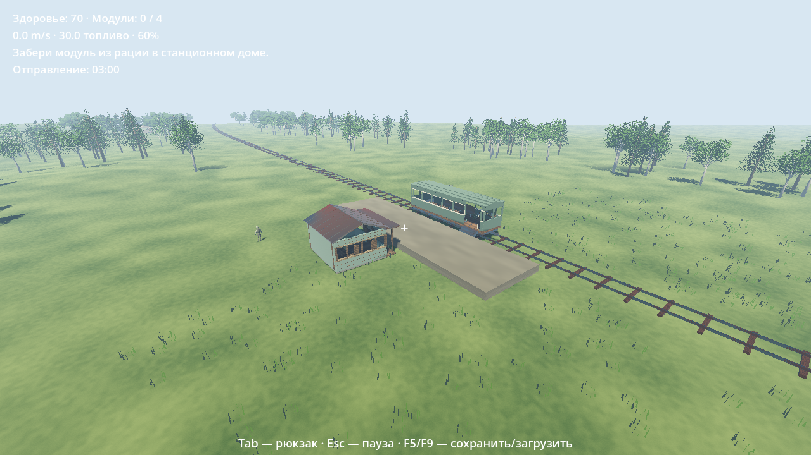
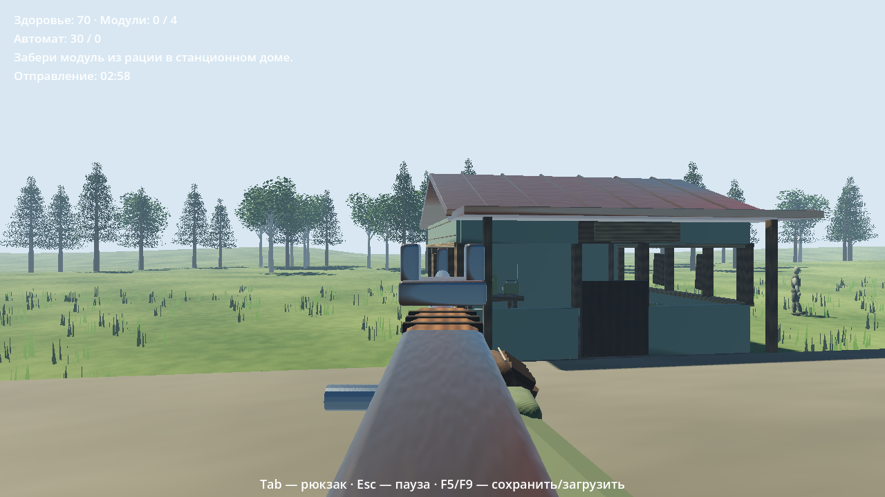
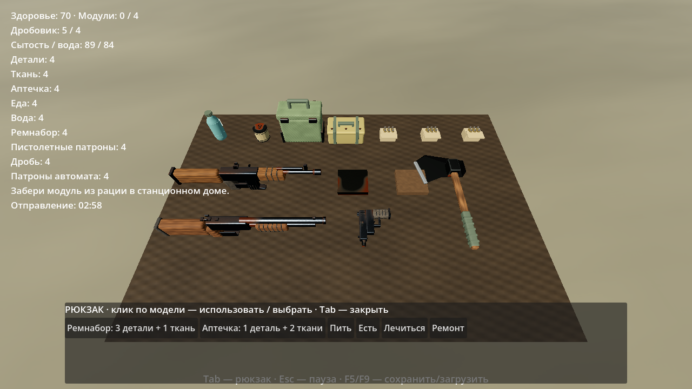
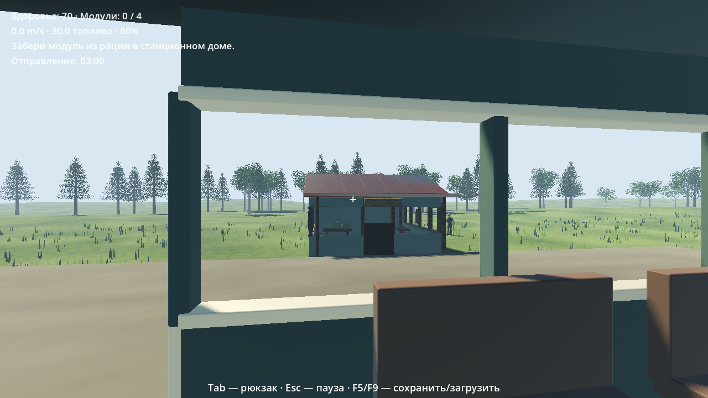
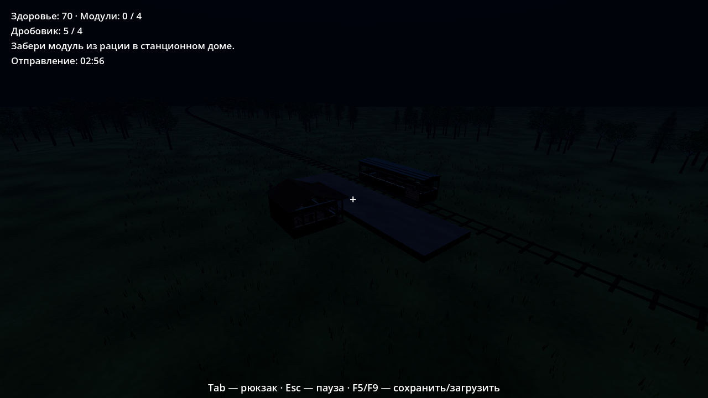
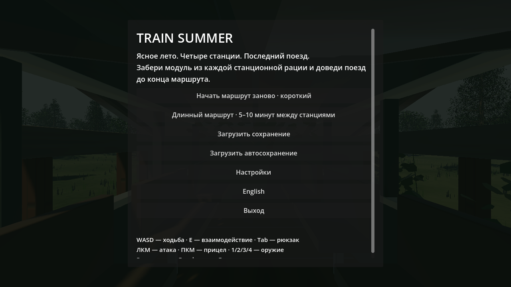

# Кадры из Godot 4.6.3

Реальный Vulkan **Forward+**, программный Mesa llvmpipe. Это не Blender и не обещанный FPS на игровой видеокарте. Графика остаётся прототипной. Обзорный кадр получен диагностической камерой; для рюкзака и демонстрации оружия capture-скрипт выдаёт предметы.

| Прицеливание | 3D-рюкзак |
|---|---|
|  |  |

| Вид из вагона | Ночь, High |
|---|---|
|  |  |

