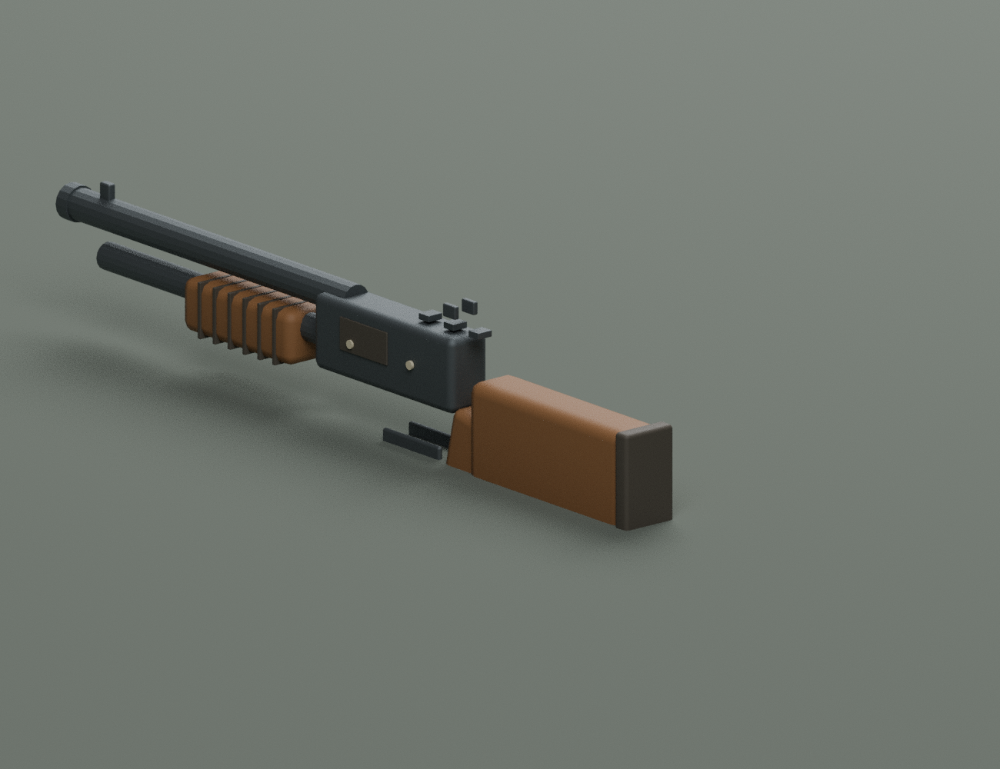
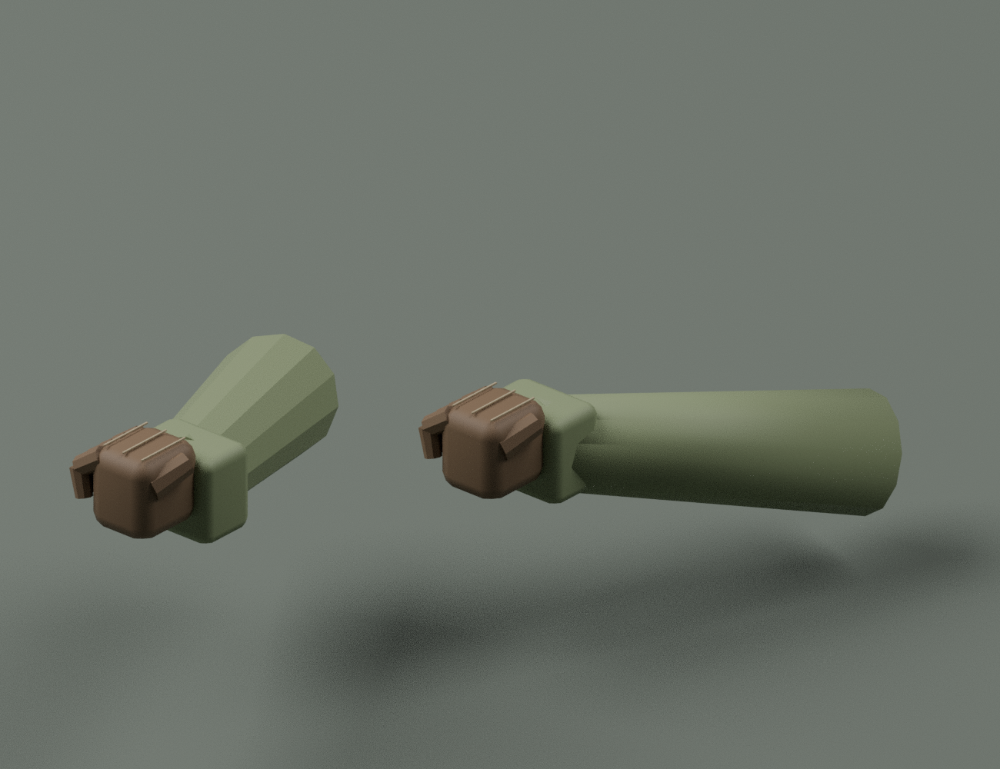
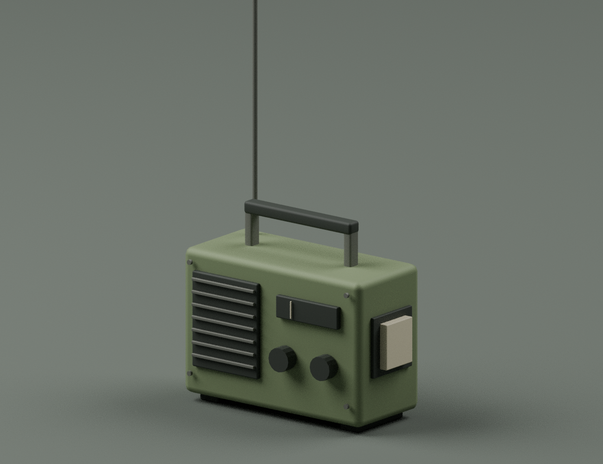
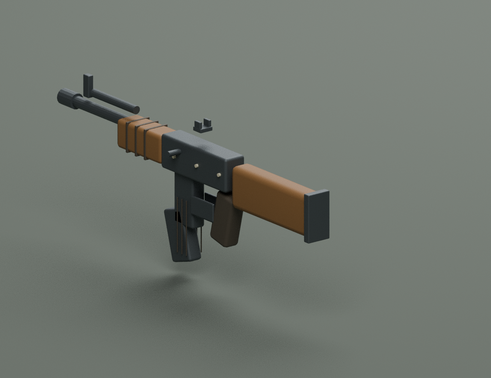
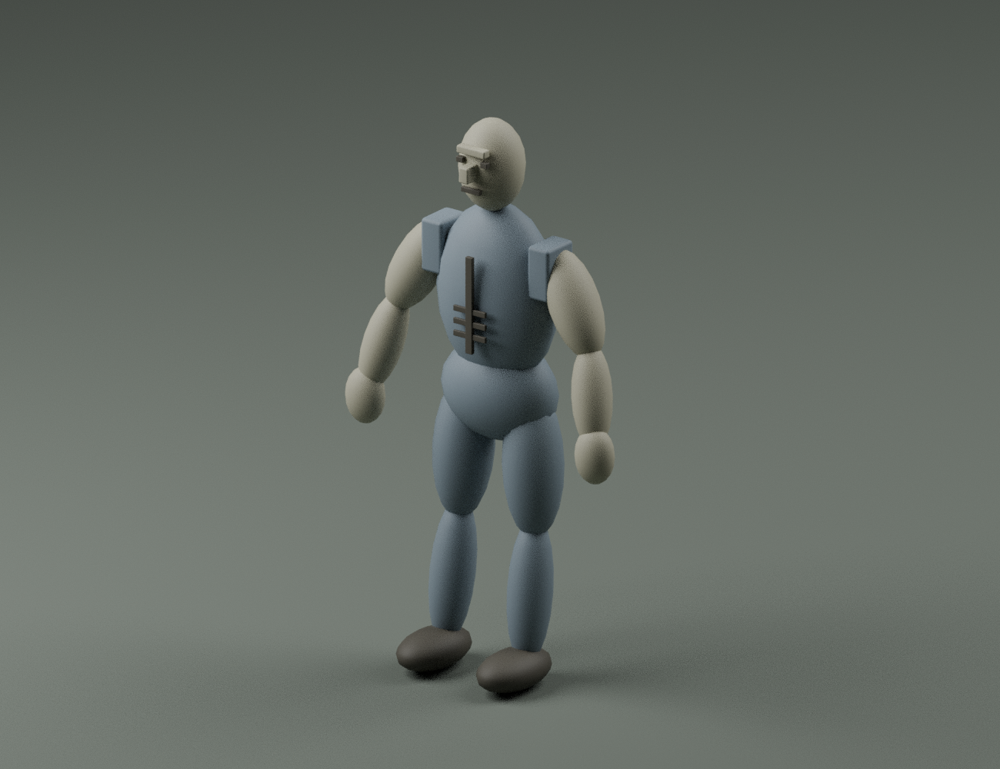
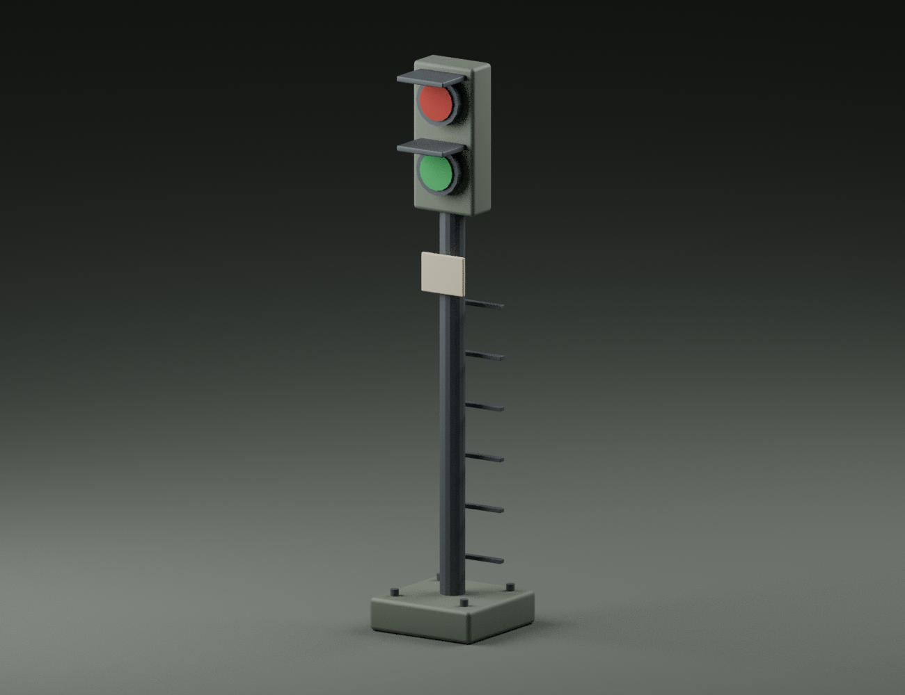
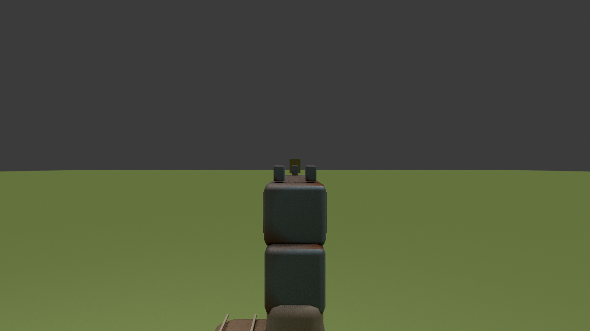
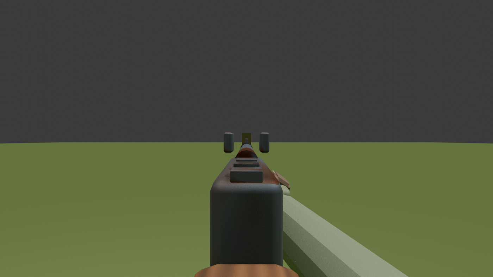
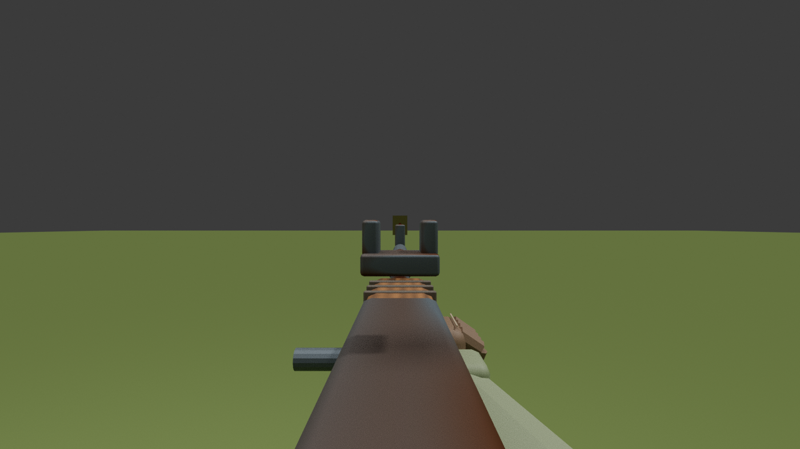

# Модели и прицеливание 0.9

Это рендеры настоящих экспортированных моделей в Blender, **не скриншоты Unity**. Геометрия, материалы, хват рук и анимации остаются прототипными.

| Дробовик | Руки в перчатках | Полевая рация |
|---|---|---|
|  |  |  |

| Автомат | Станционный зомби | Железнодорожный сигнал |
|---|---|---|
|  |  |  |

Три прицельные позы. Оружие собрано из экспортированных FBX, точки целика/мушки совмещены с центром камеры. Кадры не показывают работу C# ADS, баллистики, HUD или URP.

| Пистолет | Дробовик | Автомат |
|---|---|---|
|  |  |  |

[Прежний летний маршрут](SummerRouteEnvironment.png) · [Берёза](SummerBirch.png) · [Сосна](SummerPine.png) · [Заросший дом](OvergrownHouse.png)
