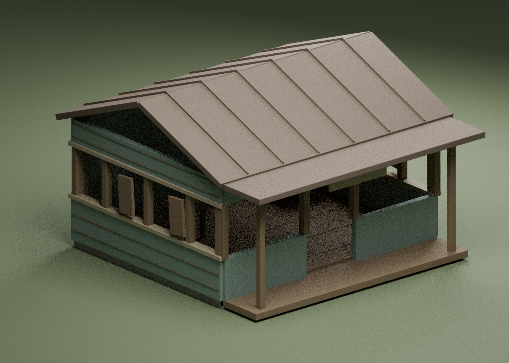
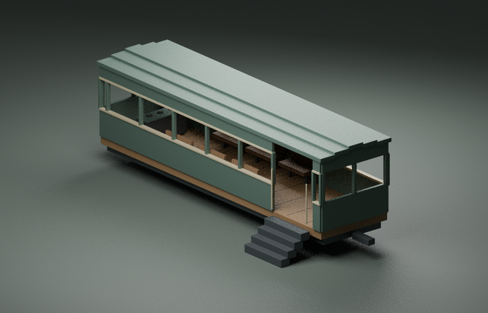

# Train Summer — прототип 0.3

Unity 2022.3 LTS / URP 14.

- [Скачать полный пакет 0.3](https://github.com/ukrger/sadas/raw/refs/heads/main/Downloads/TrainSummer_Prototype_0.3.zip)
- [Скачать модели FBX + Blender](https://github.com/ukrger/sadas/raw/refs/heads/main/Downloads/TrainSummer_Models_0.3.zip)
- [Инструкция, проверки и ограничения](README_RU.md)

## Новое
Маршрут с плавными поворотами и расстоянием вдоль кривой, четыре последовательные станции, фиксированный пул семи участков, новая модель станционного домика с интерьером и тремя LOD. Топливо находится на столе внутри дома. Добавлены Unity EditMode-тесты.

## Запуск
1. Создайте Unity 2022.3 LTS 3D (URP) проект.
2. Установите Input System и включите его в Active Input Handling.
3. Скопируйте содержимое Assets в проект, дождитесь импорта и компиляции.
4. Train Summer → Create Prototype Scene — короткий маршрут; Create Long Route Scene — перегоны примерно по 6–7 минут.
5. Play. Выйдите на станции, найдите топливо в доме за платформой, вернитесь к переднему пульту и нажмите E.

При обновлении обязательно пересоздайте сцену: добавилась RoutePath-ссылка. Ручные изменения сохраните в другой сцене перед генерацией.

Это исходники, не EXE. Изображения — Blender-рендеры базовых моделей. Экспорт и повторный импорт FBX проверены; C# прошел синтаксический разбор. Unity отсутствует в среде создания: компиляция, Unity-тесты, физика и FPS пока не проверены.
