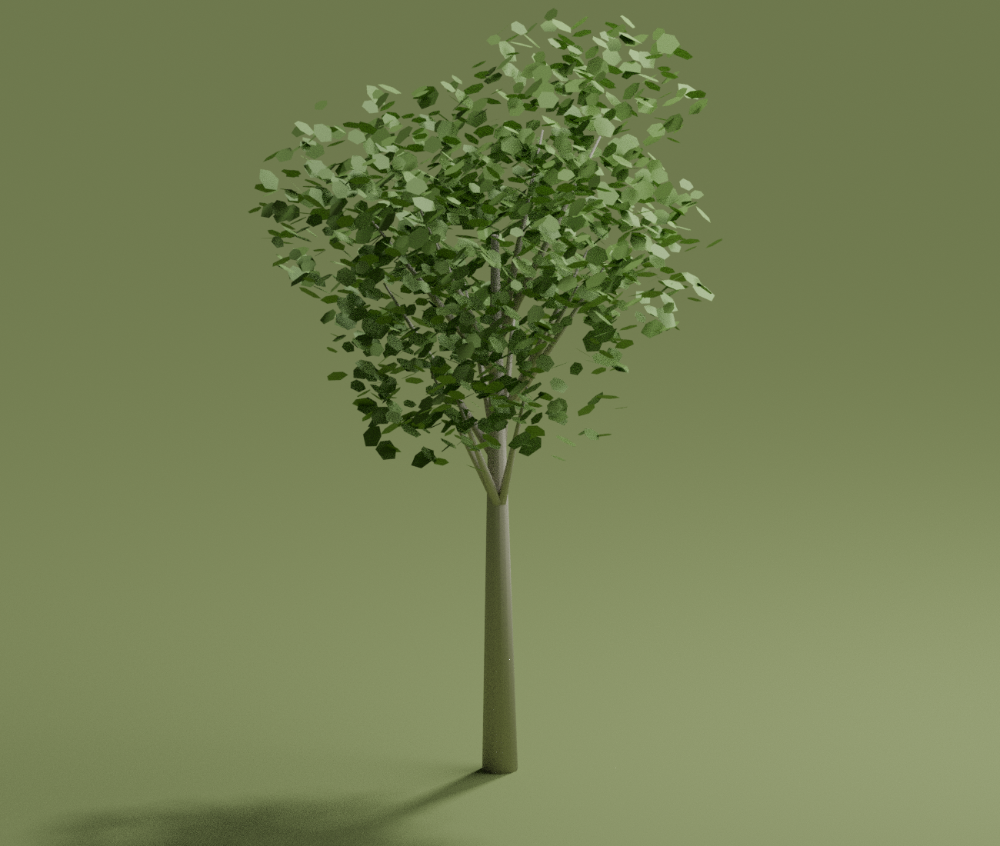
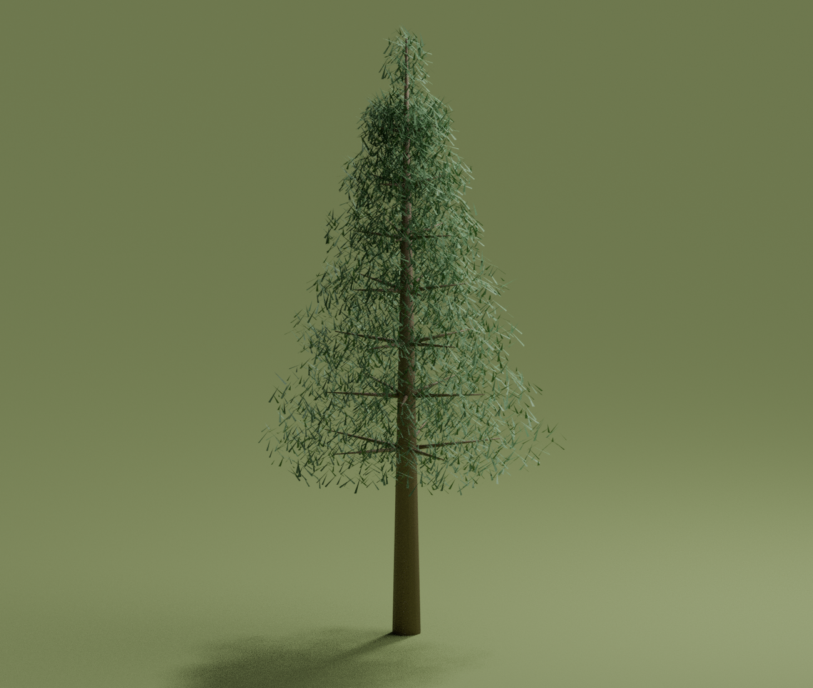
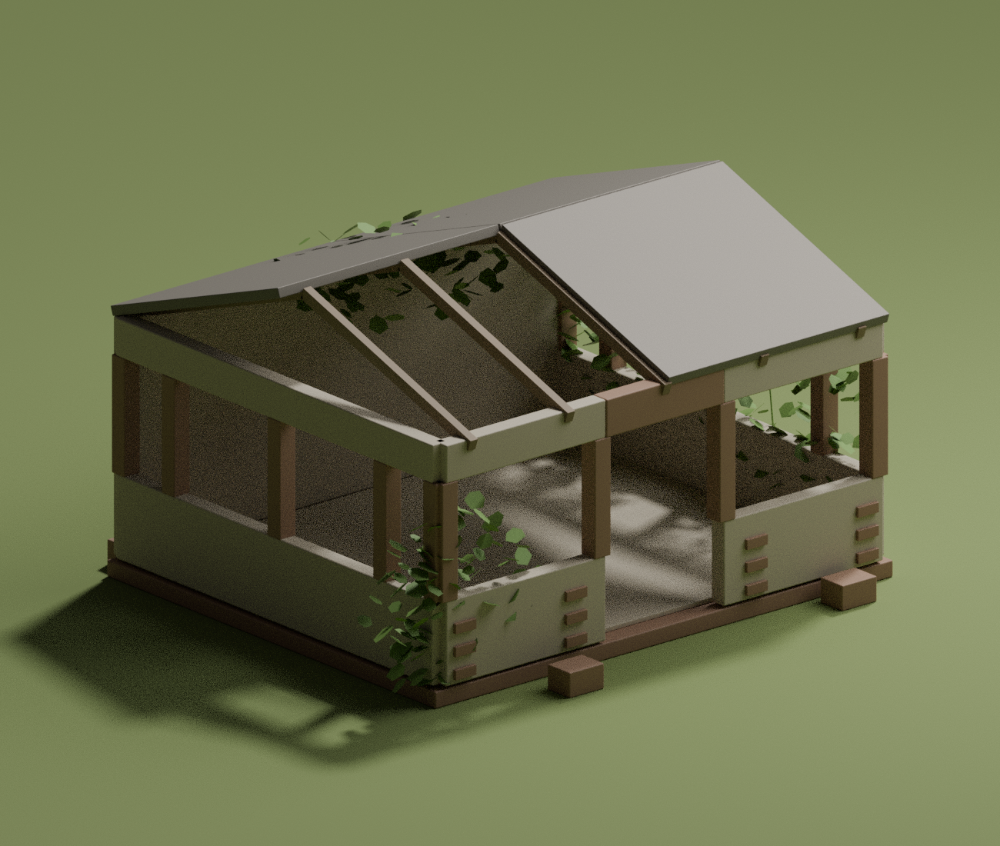
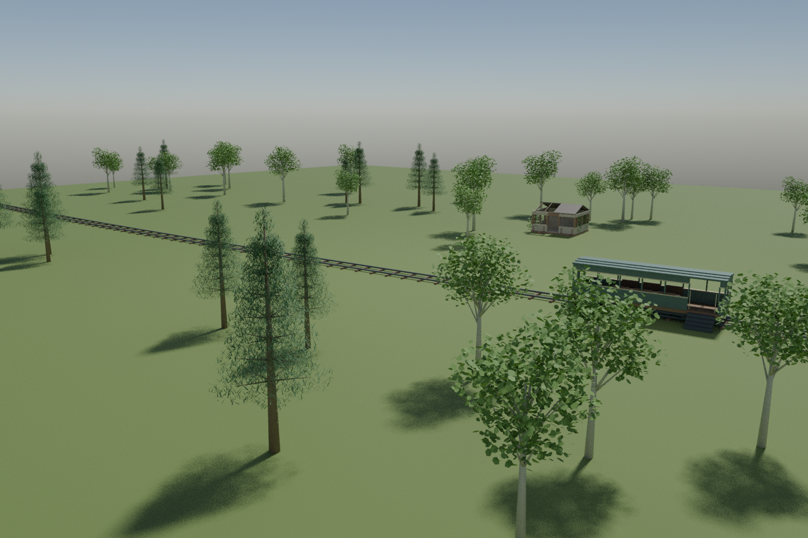

# Train Summer — прототип 0.8

Исходники и собственные модели для Unity 2022.3 LTS / URP 14.

- [Скачать полный пакет 0.8](https://raw.githubusercontent.com/ukrger/sadas/main/Downloads/TrainSummer_Prototype_0.8.zip)
- [Скачать все модели FBX + Blender](https://raw.githubusercontent.com/ukrger/sadas/main/Downloads/TrainSummer_Models_0.8.zip)
- [Установка и системы](README_RU.md)
- [Что действительно проверено](TEST_REPORT.md)

Архивы этой версии публикуются в GitHub Releases; исходники находятся в репозитории.

## Окружение 0.8
Лиственное и хвойное дерево с геометрией листвы/хвои, заросший дом с частично отсутствующей крышей. У всех трех есть FBX, .blend, генератор и три LOD.

| Лиственное | Хвойное | Заросший дом |
|---|---|---|
|  |  |  |

Изображения созданы в Blender, не являются скриншотами Unity. Превью не показывает игровой ветер/траву и не измеряет производительность.

## Код и размещение
- Явный GPU instancing деревьев/травы, программный LOD, CPU frustum culling и PBR-шейдер ветра с проходами цвета, теней и глубины для URP 14 Forward.
- Рельсы и шпалы объединены в два render-меша и один collider-меш на участок.
- Пул из 10 участков: 7 у поезда плюс до 3 возле отставшего игрока. Детерминированное размещение сохраняет проходы возле пути, станций и руин.
- F4 показывает активные участки, растения и подачи мешей. Это не полный GPU draw-call счетчик.

## Запуск
Unity 2022.3 LTS → 3D (URP), установить и включить Input System. Скопировать содержимое Assets, дождаться импорта и компиляции. Train Summer → Create Prototype Scene либо Create Long Route Scene. После обновления обязательно пересоздать сцену; ручные правки сохранить отдельно.

Сценарий создает определения растительности, материалы, травяные меши, prefab руин и остальные системы. Для standalone проверьте Graphics → Shader Stripping → Instancing Variants → Keep All.

Системы 0.7 (3D-рюкзак, крафт, еда/вода, бой, меню и сохранения) сохранены; новая декорация не добавляет ID сохраняемого лута.

## Проверки
46 независимых C#/.NET-проверок ядра выполнены. Новые FBX проверены повторным импортом, включая маски ветра и проходы дома. 69 C#-файлов разобраны синтаксически; добавлены Unity-тесты проекции пути, мешей, bounds и импорта шейдера.

**Unity здесь не установлен. C# Unity-компиляция, HLSL-компиляция, instancing, физика новых мешей, запуск сцены, интеграционные тесты и FPS пока не проверены. Увеличение FPS не установлено измерением.**

Это технический прототип, не готовая игра или EXE. Художественные материалы/текстуры, руки, анимации, lighting polish, streaming станций, разнообразный контент и оптимизация на целевом ПК остаются следующими этапами.
