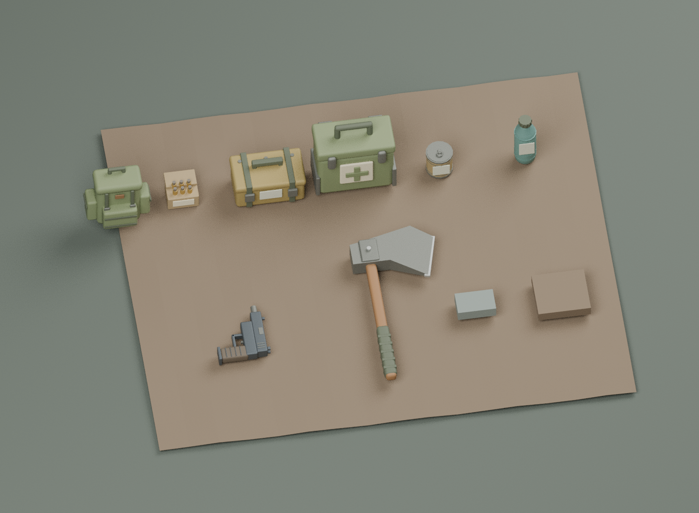
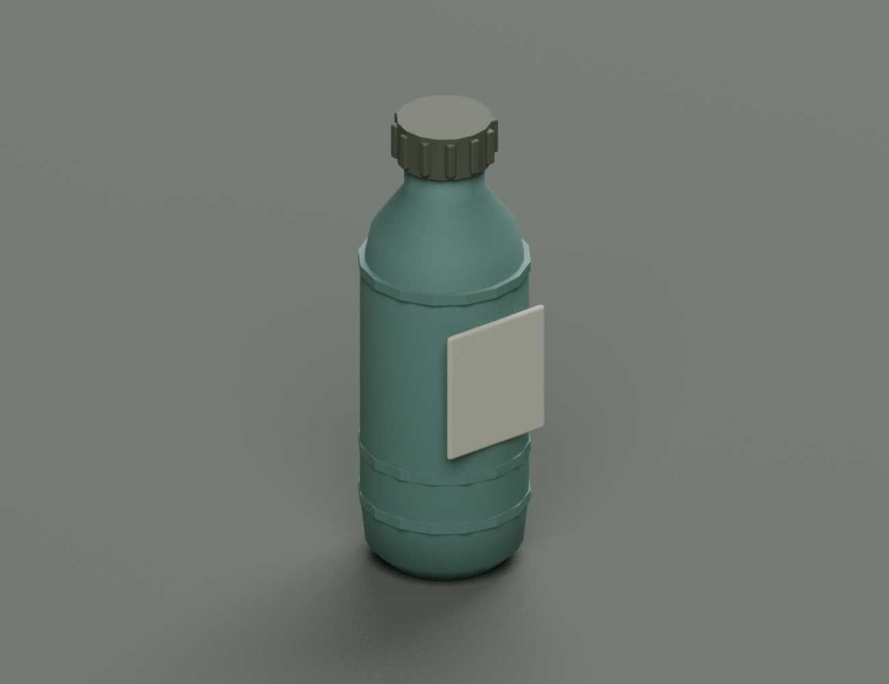
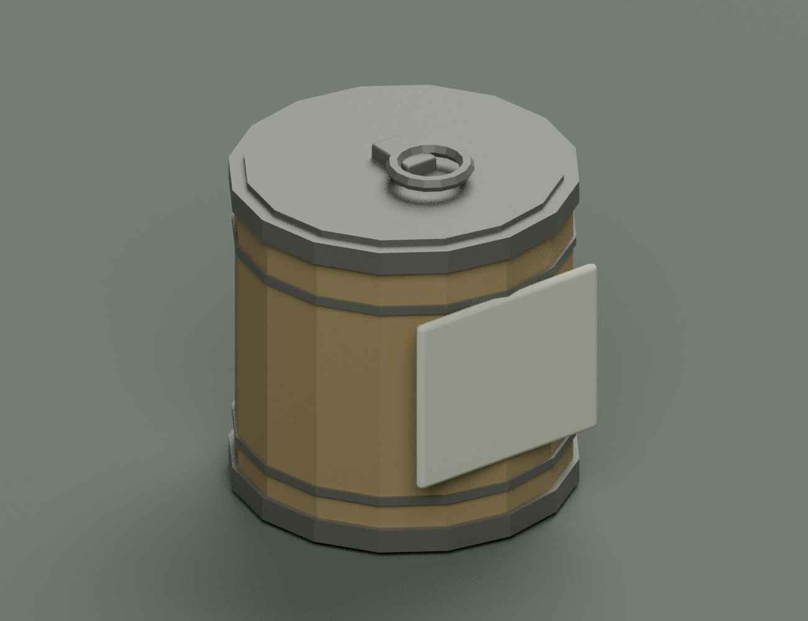
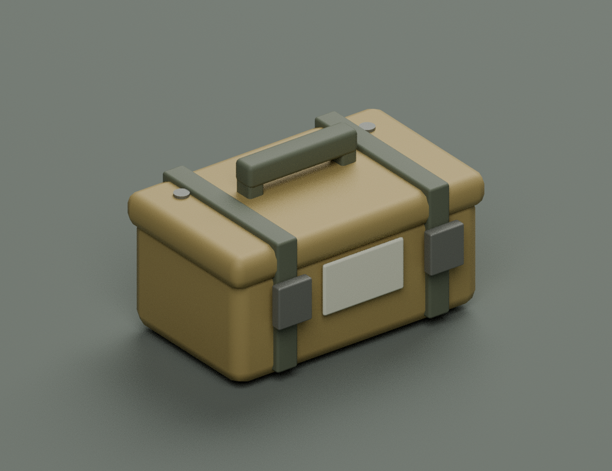

# Train Summer — прототип 0.7

Исходники и собственные модели для Unity 2022.3 LTS / URP 14.

- [Скачать полный пакет 0.7](https://github.com/ukrger/sadas/raw/refs/heads/main/Downloads/TrainSummer_Prototype_0.7.zip)
- [Скачать все текущие модели FBX + Blender](https://github.com/ukrger/sadas/raw/refs/heads/main/Downloads/TrainSummer_Models_0.7.zip)
- [Установка и системы](README_RU.md)
- [Что действительно проверено](TEST_REPORT.md)

## Новое
Tab открывает 3D-полотно с моделями предметов: камера смотрит вниз, курсор выбирает и использует предметы. Есть два рецепта крафта, сытость/вода, припасы в вагоне и станционных домах, сохранение новых предметов и миграция стандартного слота 0.6 → 0.7. Исправлена несовместимость прежнего setter разрешения теней с URP 14: теперь используются Editor-профили и runtime-копии.

Это Blender-превью из экспортированных моделей, не скриншот Unity. Игровой вариант добавляет счетчики, выбор мышью и кнопки крафта. Слоты фиксированные; drag-and-drop, руки и тканевая физика не реализованы. Мир не ставится на паузу при открытии рюкзака.

## Три новые модели

| Вода | Консервы | Ремонтный набор |
|---|---|---|
|  |  |  |

## Запуск
1. Unity 2022.3 LTS → 3D (URP). Установить и включить Input System.
2. Скопировать содержимое Assets в проект. Дождаться импорта/компиляции.
3. Train Summer → Create Prototype Scene либо Create Long Route Scene. После обновления сцену пересоздать; сохранить ручные изменения в другом файле.
4. Play: собрать припасы с пола справа за сиденьями (E). Tab — полотно, мышь — предметы и рецепты, Esc — пауза.

Для рюкзака рекомендуется URP Forward с camera stacking; слой 9 зарезервирован для моделей инвентаря.

## Проверки
36 проверок actual C#/.NET-ядра скомпилированы и выполнены: хранение файлов, ресурсы/патроны, крафт и показатели потребностей. Новые FBX повторно импортированы и проверены в Blender; 63 исходных C#-файла прошли синтаксический разбор.

**Unity здесь отсутствует. Unity-компиляция, камера/курсор рюкзака, миграция реального слота, интеграция AI/навигации, полный игровой цикл и FPS пока не проверены.**

Это технический прототип, не EXE и не завершенная игра. До полного ТЗ остаются финальные модели/текстуры/растительность/свет, руки, анимации, развитие крафта, streaming станций, контент и профилирование на целевом ПК.
