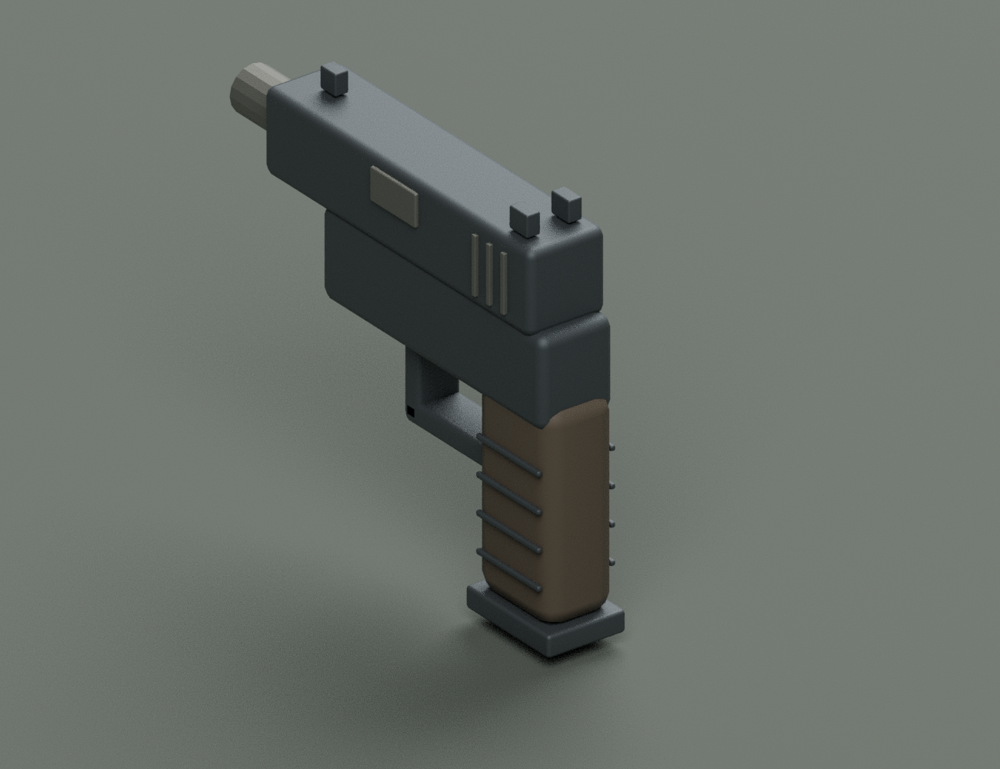
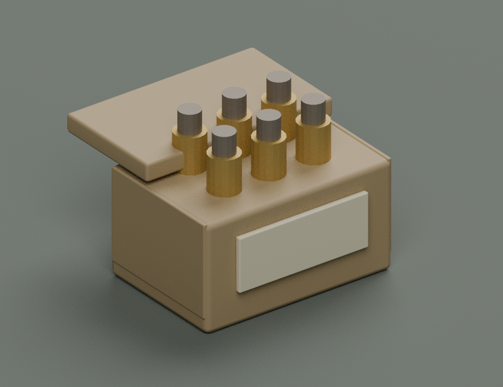
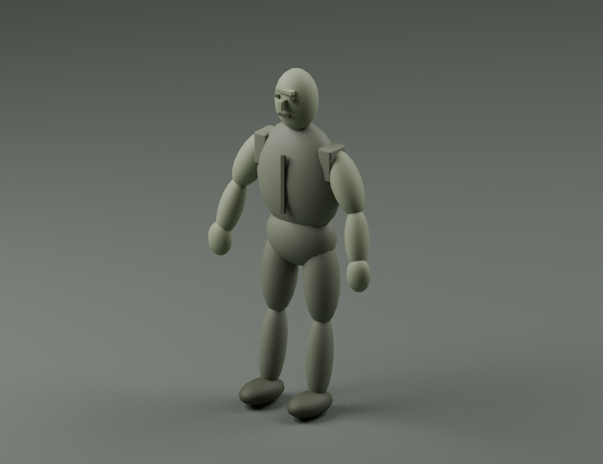

# Train Summer — прототип 0.6

Исходники и собственные модели для Unity 2022.3 LTS / URP 14.

- [Скачать полный пакет 0.6](https://github.com/ukrger/sadas/raw/refs/heads/main/Downloads/TrainSummer_Prototype_0.6.zip)
- [Скачать все текущие модели FBX + Blender](https://github.com/ukrger/sadas/raw/refs/heads/main/Downloads/TrainSummer_Models_0.6.zip)
- [Установка и описание систем](README_RU.md)
- [Что действительно проверено](TEST_REPORT.md)

## Три этапа версии 0.6
1. Базовый бой: пистолет, магазин и перезарядка, симулированные пули с гравитацией, процедурный звук, фонарик и мутанты на NavMesh со слухом/зрением.
2. Сохранения: ручной слот, отдельный autosave, резервные копии, проверка целостности и совместимости, восстановление поезд/игрок/инвентарь/лут/враги/время суток.
3. Настройки: пауза, RU/EN, пресеты качества и отдельные параметры графики, режим экрана, разрешение, FPS, V-Sync и мышь.

## Новая тройка моделей

Мутант — базовый персонаж с Generic-скелетом из 11 костей и Idle/Walk, не финальная художественная модель. Все три ассета имеют три LOD, FBX, .blend и генераторы. Рендеры сделаны в Blender.

## Запуск
1. Создайте Unity 2022.3 LTS 3D (URP) проект.
2. Установите Input System, включите его в Active Input Handling.
3. Скопируйте содержимое Assets в проект, дождитесь импорта и компиляции.
4. Train Summer → Create Prototype Scene либо Create Long Route Scene. Сцену после обновления пересоздайте.
5. Play. E — подобрать оружие у верстака; 1/2 — выбрать; ЛКМ — атака; R — перезарядка; F — фонарик; Esc — пауза; F5/F9 — сохранить/загрузить. F3 — полная справка.

Навигация станций и Animator создаются генератором сцены. До его запуска сохраните ручные изменения в другой сцене.

## Проверки
20 проверок actual C#/.NET-ядра компилировались и выполнялись: файловые замены/backup/checksum и транзакции инвентаря/патронов. FBX и скелет проверены повторным импортом в Blender, 53 исходных C#-файла прошли синтаксический разбор.

**Unity здесь не установлен. Unity-компиляция, генерация NavMesh, интеграция AI/анимации/аудио/меню, полный цикл загрузки, EditMode/PlayMode-тесты и FPS не проверены.**

Это технический прототип, не EXE и не завершенная игра. До полного ТЗ остаются физический инвентарь, руки, финальные модели/текстуры, растительность и освещение, общий крафт, streaming станций, контент и оптимизация на целевом ПК.
