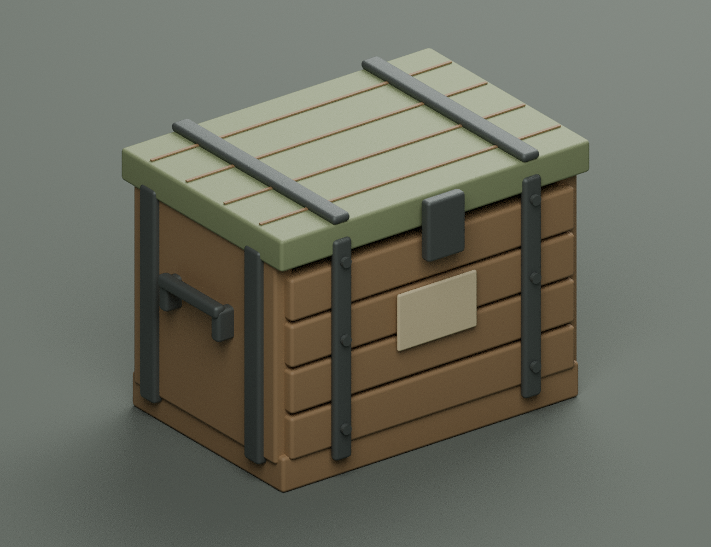
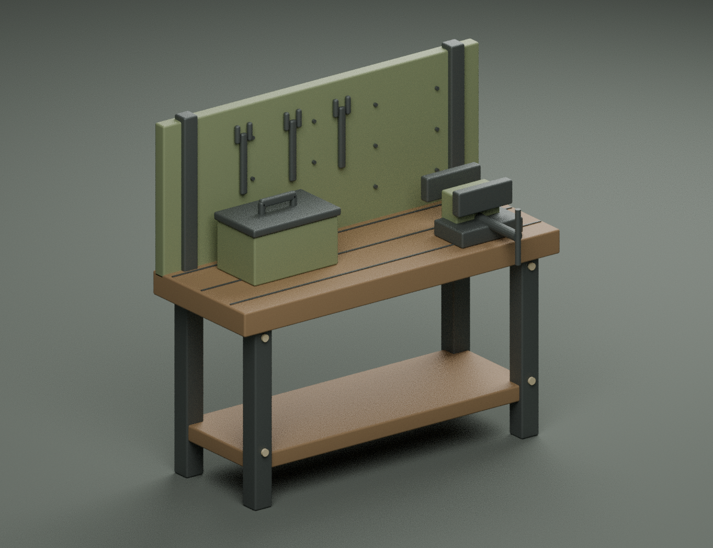

# Train Summer — прототип 0.4

Unity 2022.3 LTS / URP 14.

- [Скачать полный пакет 0.4](https://github.com/ukrger/sadas/raw/refs/heads/main/Downloads/TrainSummer_Prototype_0.4.zip)
- [Скачать все текущие модели FBX + Blender](https://github.com/ukrger/sadas/raw/refs/heads/main/Downloads/TrainSummer_Models_0.4.zip)
- [Инструкция, проверки и ограничения](README_RU.md)

## Новое
Две модели: ящик припасов и ремонтный верстак, обе с тремя LOD. В доме на каждой станции можно собрать детали и ткань, затем отремонтировать поезд на верстаке сзади слева в вагоне. Добавлены износ по расстоянию, состояние поезда, временный список ресурсов (Tab), общая система взаимодействий и тесты транзакций.

## Запуск
1. Создайте Unity 2022.3 LTS 3D (URP) проект.
2. Установите Input System и включите его в Active Input Handling.
3. Скопируйте содержимое Assets в проект и дождитесь импорта.
4. Train Summer → Create Prototype Scene — короткий маршрут; Create Long Route Scene — перегоны примерно по 6–7 минут.
5. Play: на станции войдите в дом, возьмите топливо и обыщите ящик. Вернитесь в вагон, остановите поезд, наведитесь на верстак и нажмите E. Ремонт стоит 3 детали и 1 ткань, восстанавливает до 25 пунктов состояния.

Tab — ресурсы, F3 — справка, F1 — RU/EN, F2 — FPS. Инвентарь пока показан списком; физического рюкзака нет.

При обновлении пересоздайте тестовую сцену. Сохраните ручные изменения в другой сцене перед генерацией.

Это исходники, не EXE. Рендеры сделаны в Blender. Экспорт и повторный импорт моделей проверены, C# прошел синтаксический разбор. Unity здесь отсутствует: компиляция, физика, Unity-тесты и FPS пока не проверены.
