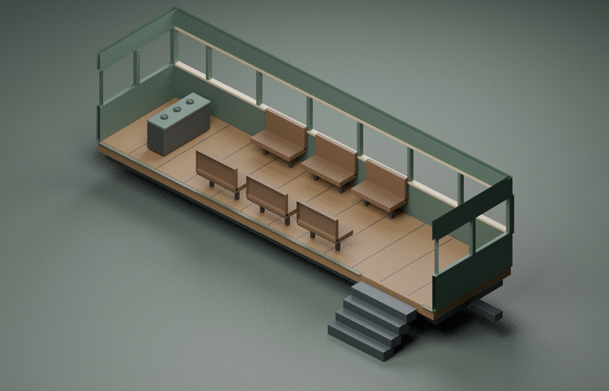

# Train Summer — прототип 0.2

Unity 2022.3 LTS / URP 14.

- [Скачать полный пакет 0.2](https://github.com/ukrger/sadas/raw/refs/heads/main/Downloads/TrainSummer_Prototype_0.2.zip)
- [Скачать модели FBX + Blender](https://github.com/ukrger/sadas/raw/refs/heads/main/Downloads/TrainSummer_Models_0.2.zip)
- [Инструкция и ограничения](README_RU.md)

В версии 0.2: новый вагон с окнами, колесными тележками, интерьером и тремя LOD; настройка URP-материалов и коллайдеров; наследование скорости платформы при прыжке.

## Рендеры моделей

Изображения получены в Blender. Исходная модель целая; разрез сделан только для изображения интерьера. Материалы базовые, без фотореалистичных текстур.

## Запуск
1. Создайте Unity 2022.3 LTS 3D (URP) проект.
2. Установите Input System и включите его в Active Input Handling.
3. Скопируйте содержимое Assets в проект и дождитесь импорта.
4. Выберите Train Summer → Create Prototype Scene, затем Play.

При обновлении пересоздайте тестовую сцену: старая сцена автоматически не обновляется. Перед генерацией сохраните ручные изменения в другой сцене.

Это исходники, не готовый EXE. Проверены Blender-экспорт, повторный импорт FBX, геометрия дверного проема и синтаксис C#. Компиляция и физика в Unity пока не проверены: Unity отсутствует в среде создания.
