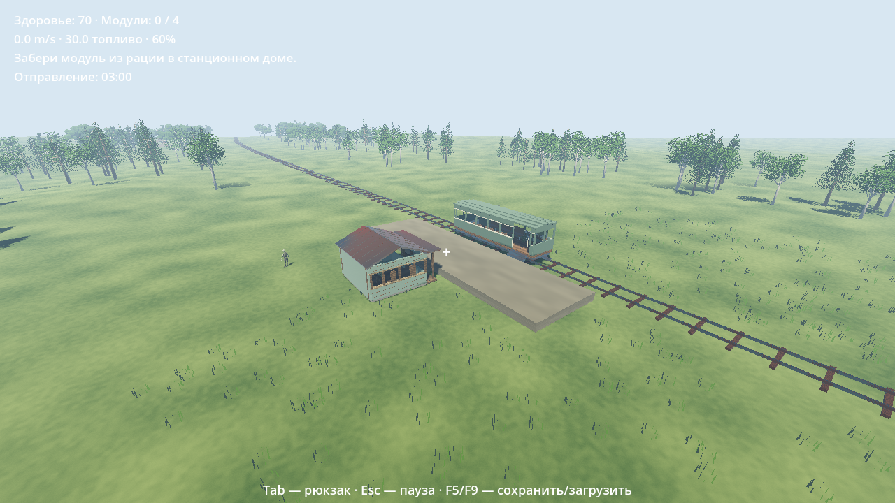
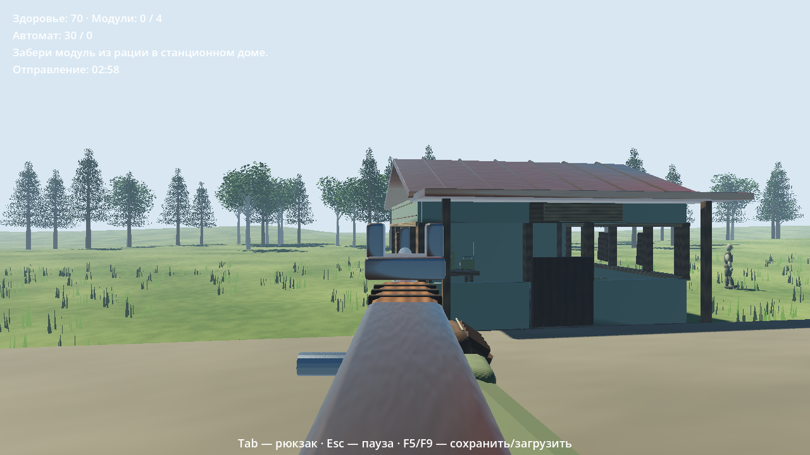

# Train Summer — версия для Godot 4.6.3

Самостоятельный запускаемый проект **Godot Standard / GDScript / Forward+**. Unity, URP, .NET и Blender для запуска не нужны. Это первая игровая версия переноса, не финальная графика уровня UE4.

- **[Скачать Godot-проект 0.1](https://raw.githubusercontent.com/ukrger/sadas/main/Downloads/TrainSummer_Godot_0.1.zip)**
- [Пошаговый запуск](Godot/README_RU.md) · [Исходники проекта](Godot) · [Результаты проверок](Godot/TEST_REPORT.md) · [Галерея](Godot/previews/README.md)

Распаковать архив → Godot **Import** → выбрать **project.godot** → дождаться импорта → **F5** → «Начать маршрут». Кнопка длинного маршрута находится в главном меню.

Перенесены поезд/остановки/топливо/ремонт, вылазки и лут, потребности/крафт/3D-рюкзак, топор/пистолет/дробовик/автомат с ADS и баллистикой, враги/NavMesh/шум/фонарь, меню RU/EN, цель из четырёх радиомодулей и сохранения с резервной копией. Включены 23 собственные GLB-модели и процедурные текстуры.

Оптимизация: 10 чанков, MultiMesh/LOD/frustum, объединённый путь, conservative occlusion, ограниченные тени/трава и отключение дальних станций. Это архитектурные меры; **60 FPS на целевом ПК пока не подтверждены**.

**Проверено настоящим Godot:** 73 основных проверки, 6 проверок длинного маршрута; реальный Vulkan Forward+ рендер через программный llvmpipe. Windows EXE и полный длинный playthrough не проверены. Все изображения ниже — реальные кадры движка, не Blender; обзор снят диагностической камерой.

| Прицеливание | 3D-рюкзак |
|---|---|
|  |  |

Предыдущая Unity-версия 0.9

# Train Summer — прототип 0.9

Unity 2022.3 LTS / URP 14 Forward. Пакет исходников, собственных моделей/текстур и генераторов, **не готовая игра или собранный EXE**.

- [Скачать полный пакет 0.9](https://raw.githubusercontent.com/ukrger/sadas/main/Downloads/TrainSummer_Prototype_0.9.zip)
- [Скачать все модели FBX + Blender 0.9](https://raw.githubusercontent.com/ukrger/sadas/main/Downloads/TrainSummer_Models_0.9.zip)
- [Галерея новых моделей и прицеливания](Previews/README.md)
- [Инструкция](README_RU.md) · [Проверки](TEST_REPORT.md) · [Сборка/тесты](Docs/BUILD_AND_TEST_RU.md) · [URP](Docs/URP_SETUP_RU.md) · [Статусы этапов](Docs/ROADMAP_RU.md)

## Прицеливание и бой
Удержание ПКМ плавно совмещает мушку/целик с центром камеры для пистолета, дробовика и автомата. FOV, чувствительность, скорость ходьбы, разброс и покачивание меняются вместе с ADS. Отдача сдвигает настоящий взгляд; смена оружия, рюкзак, пауза, смерть и загрузка сбрасывают прицел. Перезарядка выводит из ADS. Это механические прицелы, без оптики/пристрелки.

1/2/3/4 — топор/пистолет/дробовик/автомат; ЛКМ — атака, R — зарядка. Дробовик выпускает 8 дробин и заряжается по одному патрону; автомат стреляет удержанием ЛКМ. Раздельные магазины/резервы сохраняются. Руки статические, следуют процедурному pivot, без финальной скелетной зарядки.

## Несколько этапов в одном обновлении
- Цель маршрута: 4 радиомодуля в станционных рациях, безопасный таймер/ручное отправление, экран результата.
- Стартовое меню, пауза/настройки, смерть, загрузка, сохранения schema 3 с миграцией стандартных слотов 0.6–0.8.
- Шесть моделей, двумя тройками: дробовик/руки/рация и автомат/зомби/сигнал; FBX, BLEND, три LOD, генераторы и фотографии.
- Ясное небо, луна/звёзды, screen-space sun shafts URP, 21 процедурная PBR-карта и синтезированный временный звук.
- Сохранены GPU instancing/LOD/wind и пул 10 участков; дальние станции отключают AI/NavMesh/коллизии, но остаются в памяти. Подготовлена команда bake occlusion.
- Проверка ссылок сцены и команда Windows Development Build.

## Запуск
URP-проект Unity 2022.3 LTS, Input System → Active Input Handling New/Both. Скопировать Assets, дождаться импорта/компиляции. Train Summer → Create Prototype Scene или Create Long Route Scene, Play → Начать маршрут. После обновления **пересоздать сцену**, ручные правки сохранить отдельно. Instancing Variants → Keep All для первого standalone-прогона.

## Что проверено
93 независимые проверки C#-ядра реально выполнены. 92 C#-файла разобраны синтаксически. Новые FBX/LOD/скелет/анимации проверены повторным импортом в Blender; геометрическое выравнивание прицелов проверено в Blender. PBR-карты экспортированы тем же production C#-кодом.

**Unity здесь не установлен. Компиляция C#/HLSL, запуск сцены, ADS в игре, физика, NavMesh, интеграционные тесты, Windows Build и FPS ещё не проверены. Все фотографии — Blender-превью. Финальная графика, анимации, звук, разнообразие контента и оптимизация требуют дальнейшей проверки в движке.**

