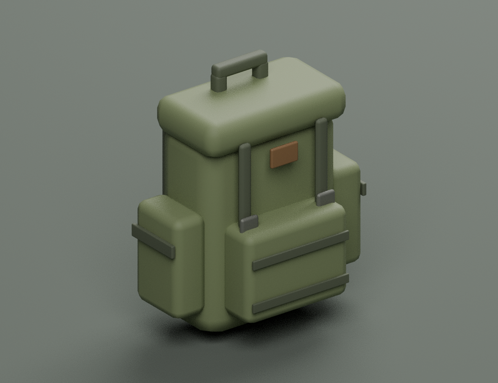
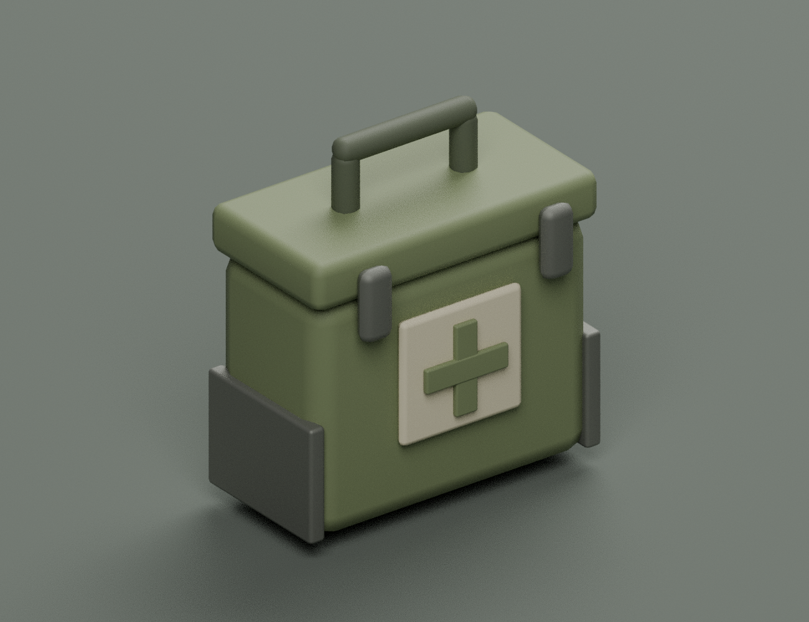
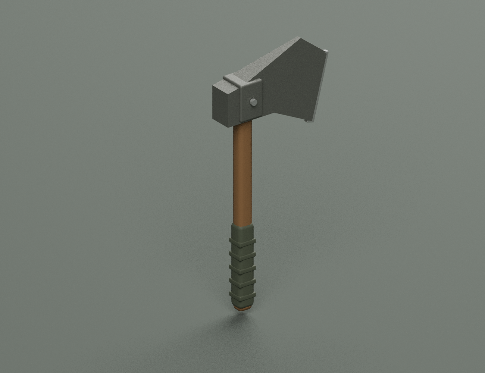

# Train Summer — прототип 0.5

Unity 2022.3 LTS / URP 14.

- [Скачать полный пакет 0.5](https://github.com/ukrger/sadas/raw/refs/heads/main/Downloads/TrainSummer_Prototype_0.5.zip)
- [Скачать все текущие модели FBX + Blender](https://github.com/ukrger/sadas/raw/refs/heads/main/Downloads/TrainSummer_Models_0.5.zip)
- [Инструкция, проверки и ограничения](README_RU.md)

## Новые модели

Все три имеют три LOD, FBX, Blender-исходники и генераторы. Рендеры получены в Blender.

## Новая вылазка
Возьмите топор у верстака сзади слева в вагоне (E). На станции разбейте доски на входе тремя ударами (ЛКМ). Внутри дома находятся топливо, ящик припасов и аптечка. H использует аптечку, 1 убирает/достает топор. Рюкзак в вагоне открывает список предметов (E или Tab).

Добавлены здоровье, урон от сильного падения, возврат в поезд после гибели по R и базовый удар с проверкой первого препятствия. Рук и полноценной боевой анимации пока нет. Рюкзак пока открывает список, а не физическое полотно с предметами.

## Запуск
1. Создайте Unity 2022.3 LTS 3D (URP) проект.
2. Установите Input System и включите его в Active Input Handling.
3. Скопируйте содержимое Assets в проект, дождитесь импорта и компиляции.
4. Train Summer → Create Prototype Scene — короткий маршрут; Create Long Route Scene — длинный.
5. Play. F3 — справка по управлению.

При обновлении обязательно пересоздайте тестовую сцену. Ручные изменения сохраните в другой сцене перед генерацией.

Это исходники, не EXE. Экспорт и повторный импорт FBX проверены; 28 C#-файлов прошли синтаксический разбор. Unity здесь отсутствует: компиляция, физика, Unity-тесты и FPS пока не проверены.
